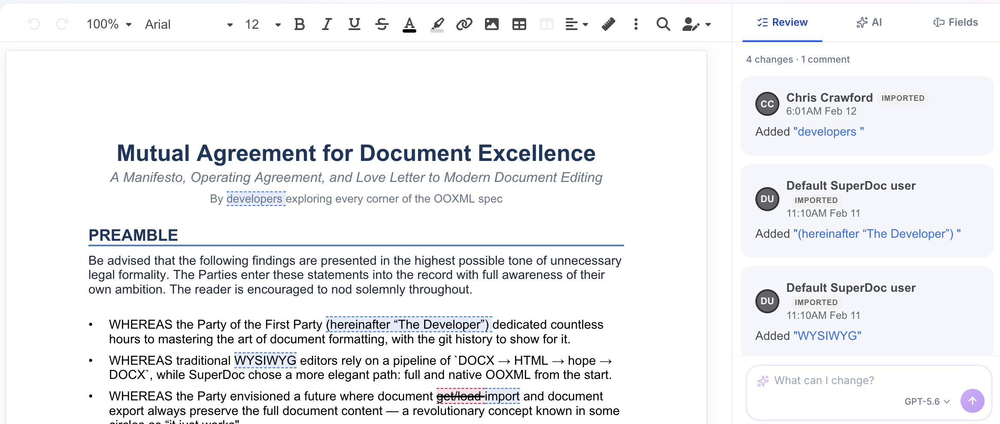
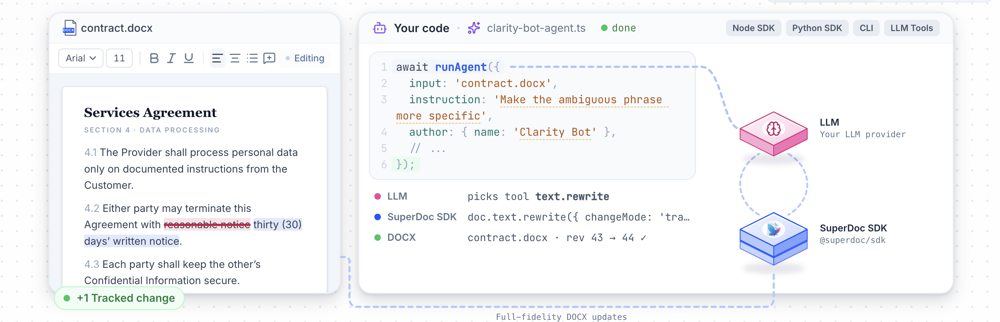

<h1 align="center">
  <a href="https://www.superdoc.dev"></a>
</h1>

<div align="center">
  <a href="https://www.npmjs.com/package/superdoc" target="_blank"></a>
  <a href="https://www.npmjs.com/package/superdoc" target="_blank"></a>
  <a href="https://www.gnu.org/licenses/agpl-3.0" target="_blank"></a>
  <a href="https://discord.com/invite/b9UuaZRyaB" target="_blank"></a>
</div>

<p align="center">
  <strong>SuperDoc</strong> is the open source DOCX Editor and Agent SDK for reviewing, filling, and editing DOCX files.
</p>

- ✅️ **MS Word Compatible**: DOCX-native editing with Word-compatible formatting, tracked changes, threaded comments, tables, headers, footers and pagination. SuperDoc edits OOXML without an HTML conversion step.
- 🛠️️ **Self-hosted**: Runs in the browser (JS/TS) or within your own headless server and agentic workflows (Node, Python, Rust, CLI, MCP).
- 🔒️ **Secure**: SuperDoc is part of your infrastructure. It does not require document content to be sent to us.
- 🎨️ **Customizable**: build SuperDoc into your product with our Built-in UI or your own custom UI components. You control the product experience.

<p align="center">
  <a target="_blank" href="https://www.superdoc.dev">Live demo</a> · <a target="_blank" href="https://docs.superdoc.dev">Documentation</a> · <a href="#quick-start-docx-editor">Editor quickstart</a> · <a href="#quick-start-docx-agent">Agent quickstart</a> · <a href="#community">Community</a> · <a target="_blank" href="https://github.com/superdoc/docx-editor/issues/new?template=bug-report.yml">Report bug</a> · <a target="_blank" href="https://www.superdoc.dev/contact">Contact</a>
</p>

> 🤖️ LLM coding agents can get started quickly with our [`llms.txt`](https://docs.superdoc.dev/llms.txt) and [`starter prompts`](https://docs.superdoc.dev/#agent-prompts).

## Quick start: DOCX editor

<a href="https://www.superdoc.dev" target="_blank"></a>

Add the SuperDoc editor to your web application. Use the built-in UI or provide
your own UI. <a target="_blank" href="https://www.superdoc.dev">View a live demo</a>.

```bash
npm install superdoc
```

Place a DOCX at `/sample.docx`, or omit `document` to start with a blank document.

```html
<!-- Where SuperDoc mounts in your product -->
<div id="toolbar"></div>
<div id="editor"></div>
<button id="export" type="button" disabled>Export DOCX</button>
```

```js
import { SuperDoc } from 'superdoc';
import 'superdoc/style.css';

// Init the SuperDoc Editor
const superdoc = new SuperDoc({
  selector: '#editor',
  document: '/sample.docx', // URL or File/Blob
  documentMode: 'editing', // 'editing' | 'suggesting' | 'viewing'
  ui: { toolbar: { container: '#toolbar' } },
  onReady: () => { document.querySelector('#export').disabled = false; },
});

// Programmatically control document actions
document.querySelector('#export').addEventListener('click', async () => {
  await superdoc.export({ exportType: ['docx'], exportedName: 'sample-edited' });
});
```

The editor runs entirely in the browser and does not need a server to render or edit a
document.

> 📖️ Docs: Follow the [editor quickstart](https://docs.superdoc.dev/editor/quickstart)
for a complete vanilla JavaScript or React project, then
[configure the editor](https://docs.superdoc.dev/editor/configuration) and
[choose a document mode](https://docs.superdoc.dev/editor/document-modes).

## Quick start: DOCX agent

<a href="https://www.superdoc.dev" target="_blank"></a>

Use a headless SDK in your server code and agentic workflow to review and edit DOCX files. With real-time collaboration configured, agents and users can edit the same document at the same time.

This example uses the SuperDoc Node SDK (Rust and Python are also available) and the [Vercel AI SDK](https://ai-sdk.dev/docs/ai-sdk-core/tools-and-tool-calling) to let an LLM inspect a sample contract and propose tracked changes. Document content sent to the model is subject to the model provider's policies.

```bash
npm install @superdoc/sdk ai@6 @ai-sdk/anthropic@3
curl -fL https://raw.githubusercontent.com/superdoc/docx-editor/refs/heads/main/assets/sample-contract.docx -o sample-contract.docx
```

Set `ANTHROPIC_API_KEY` to your Anthropic API key and `ANTHROPIC_MODEL` to a model ID available to your account before running the example.

```js
import { SuperDocClient, createAgentToolkit } from '@superdoc/sdk';
import { anthropic } from '@ai-sdk/anthropic';
import { generateText, jsonSchema, stepCountIs } from 'ai';

// Init SuperDoc
const client = new SuperDocClient({
  user: { name: 'Contract assistant', email: 'assistant@example.com' }
});

// Insert tracked changes
let doc;
try {

  // Open DOCX with SuperDoc client
  await client.connect();
  doc = await client.open({ doc: './sample-contract.docx' });

  // Init your agent of choice and SuperDoc tools
  const toolkit = await createAgentToolkit({
    provider: 'vercel', preset: 'core', enforceChangeMode: 'tracked',
  });
  let failed = false;
  let edited = false;

  // Perform SuperDoc tool actions
  const tools = Object.fromEntries(toolkit.tools.map(tool => [tool.name, {
    description: tool.description,
    inputSchema: jsonSchema(tool.inputSchema),
    execute: async args => {
      try {
        const result = await toolkit.dispatch(doc, tool.name, args);
        if (tool.name === 'superdoc_perform_action') {
          if (result.status !== 'ok' || result.verificationPassed === false) {
            throw new Error('Document edit failed verification.');
          }
          edited = true;
        }
        return result;
      } catch (error) {
        failed = true;
        throw error;
      }
    },
  }]));

  // Get new text and SuperDoc tool calls from any LLM provider
  const result = await generateText({
    model: anthropic(process.env.ANTHROPIC_MODEL),
    system: toolkit.systemPrompt,
    prompt: 'Change payment terms from 60 to 30 days',
    tools,
    stopWhen: stepCountIs(10),
  });
  if (failed || !edited || result.finishReason !== 'stop') {
    throw new Error('Agent did not complete an edit; output was not saved.');
  }

  // (Optional) Extra verification check
  const text = await doc.getText({});
  const { items } = await doc.trackChanges.list({});
  const tracked = items.some(change => change.authorEmail === 'assistant@example.com' &&
    change.deletedText?.includes('60') && change.insertedText?.includes('30'));
  if (!tracked || text.includes('Within 60 days') ||
      text.match(/Within 30 days/g)?.length !== 2) {
    throw new Error('Payment terms were not changed as tracked edits; output was not saved.');
  }

  // Save resulting DOCX with new tracked change
  await doc.save({ out: './sample-contract-with-tracked-change.docx' });
  console.log(result.text);

} finally {
  try { await doc?.close({ discard: true }); }
  finally { await client.dispose(); }
}
```

Your own LLM chooses the SuperDoc tools for reading and updating the DOCX; SuperDoc executes document operations and can (optionally) enforce making edits as tracked.

> 📚️ Docs: See [Build an agent](https://docs.superdoc.dev/agents/build/build-an-agent) for
a full loop and verification guidance. You can also seamlessly connect users and agents with [Real-time collaboration](https://docs.superdoc.dev/editor/collaboration/).

## How SuperDoc works

SuperDoc reads, renders, edits, and writes DOCX files through their Office Open
XML (OOXML) parts. Edits write back to OOXML without an intermediate HTML
conversion step.

1. **Open.** The engine parses content, styles, relationships, media, headers,
   footers, and the other OOXML parts into editable document state.
2. **Render.** The layout engine paginates that state. The browser painter
   projects the resolved pages into the Document Object Model (DOM). OOXML
   remains the document format.
3. **Edit.** Editor input and headless operations update document state. The
   Document API defines queries, targets, mutations, and receipts.
4. **Write.** Save and export write the changes back into the OOXML package
   instead of rebuilding a DOCX from HTML.

### Release channels

| Channel | Cadence | Install | Use it for |
| --- | --- | --- | --- |
| **Stable** (`latest`) | Twice a week (Tues, Fri) | `npm install superdoc` | Production applications. |
| **Next** (`next`) | Continuous, from `main` | `npm install superdoc@next` | Trying fixes and features before they reach stable. |

> 📰️ [Release notes](https://github.com/superdoc/docx-editor/releases)

### NPM Packages and SDKs

| NPM Package | Purpose |
| --- | --- |
| [`superdoc`](https://www.npmjs.com/package/superdoc) | Browser DOCX editor for vanilla JavaScript and TypeScript. |
| [`@superdoc/react`](https://www.npmjs.com/package/@superdoc/react) | React wrapper for the editor. |
| [`@superdoc/vue`](https://www.npmjs.com/package/@superdoc/vue) | Vue wrapper for the editor. |
| [`@superdoc/sdk`](https://www.npmjs.com/package/@superdoc/sdk) | Node.js SDK for headless DOCX editing and agent toolkits. |
| [`@superdoc/cli`](https://www.npmjs.com/package/@superdoc/cli) | `superdoc` command-line interface. |
| [`@superdoc/mcp`](https://www.npmjs.com/package/@superdoc/mcp) | MCP server for AI agents and MCP clients. |
| [`@superdoc/fonts`](https://www.npmjs.com/package/@superdoc/fonts) | Optional metric-compatible font substitutes. |

| Language | Package | Status |
| --- | --- | --- |
| Python | [`superdoc-sdk`](https://pypi.org/project/superdoc-sdk/) on PyPI | Stable and next channels. See the [Python SDK guide](https://docs.superdoc.dev/agents/automation/python-sdk). |
| Rust | [`superdoc-sdk`](https://crates.io/crates/superdoc-sdk) on crates.io | See the [Rust SDK README](packages/sdk/langs/rust/README.md) for installation and release information. |

## For AI agents and LLMs

### Find documentation

1. Choose the browser editor for interactive editing or a headless SDK, CLI, or MCP server for automation.
2. Read [`llms.txt`](https://docs.superdoc.dev/llms.txt) and follow the links for your runtime and task.
3. Read the relevant API reference or advertised tool schema before constructing an operation. Use the focused reference pages when you need only a few operations.
4. Check capabilities for the active runtime and document. Inspect mutation receipts and errors before treating an edit as complete, then save the document.

Machine-readable documentation:

- [`llms.txt`](https://docs.superdoc.dev/llms.txt): index of every documentation page, with links to the exports below.
- [`llms-full.txt`](https://docs.superdoc.dev/llms-full.txt): all authored guides in one file, without the generated API reference.
- [`llms-reference.txt`](https://docs.superdoc.dev/llms-reference.txt): the complete generated Document API reference. Prefer focused [reference pages](https://docs.superdoc.dev/document-api/reference) when only a few operations are needed.
- [Context7](https://context7.com/superdoc/docx-editor): the documentation indexed for retrieval.

### Discover tools and operations

- The [MCP server](https://docs.superdoc.dev/agents/mcp/connect) gives any MCP client the same engine the editor and SDK use.
- Every tool's JSON Schema is generated from the Document API contract and served over MCP. `getToolCatalog()` in `@superdoc/sdk` returns the same data. Read the advertised schema rather than a copy of it.
- `superdoc discover "<intent>"` and `superdoc describe command <name>` search and explain the CLI contract.
- A [custom-actions skill](https://docs.superdoc.dev/agents/build/skills) teaches Claude Code or Codex to extend the SDK's action surface correctly.
- [Agent safety](https://docs.superdoc.dev/agents/operate/safety) covers filesystem boundaries, document content sent to model providers, and review.

### Package names and usage rules

- Browser editor: import `SuperDoc` from `superdoc` and load `superdoc/style.css`.
- Node.js SDK: import `SuperDocClient` from `@superdoc/sdk`. Use this SDK for Node.js API routes; the browser editor needs a browser environment.
- Python SDK: install `superdoc-sdk`, then import `SuperDocClient` from the `superdoc` module.
- CLI: install `@superdoc/cli` to use the `superdoc` command.
- MCP server: use `@superdoc/mcp` with an MCP client.
- Document modes are `'editing'`, `'suggesting'`, and `'viewing'`. These modes control editor behavior; your application manages access permissions.
- To record edits as tracked changes, use `documentMode: 'suggesting'` in the editor or `changeMode: 'tracked'` for supported headless mutations.
- For targeted text edits, find a target with `query.match` and pass the returned target to the mutation. Do not construct targets from OOXML IDs.

Agents working in this repository start with [`AGENTS.md`](AGENTS.md).

## Demos and examples

See our quick code examples in [`examples/`](examples).

Or run full demo applications (with Custom UI) here: [demos.superdoc.dev](https://demos.superdoc.dev/).

## Security and trust

SuperDoc runs inside your infrastructure: in the browser, on your servers, or
within your agents. It does not require document content to be sent to or
stored by SuperDoc.

For enterprise security reviews, a
SOC 2 Type II report, security documentation, architecture and data-flow
materials, and a software bill of materials are available. See
[Trust & Security](https://docs.superdoc.dev/resources/security).

Report suspected vulnerabilities privately as described in [SECURITY.md](SECURITY.md).

## Community

- [Discord](https://discord.com/invite/b9UuaZRyaB) for questions and discussion with the SuperDoc team and other builders.
- [Documentation](https://docs.superdoc.dev) for guides and the API reference.
- [Changelog](https://www.superdoc.dev/changelog) for major product updates.
- [Release notes](https://github.com/superdoc/docx-editor/releases)

## Contributing

Community contributions can include submitting an
[issue](https://github.com/superdoc/docx-editor/issues/new/choose). Bug reports,
feature requests, and technical investigations are welcome. Pull requests are
limited to repository collaborators. Read the
[contributing guide](CONTRIBUTING.md) for why and how to help, or join
[Discord](https://discord.com/invite/b9UuaZRyaB) for questions.

This project follows a [Code of Conduct](CODE_OF_CONDUCT.md).

## Contributors

Thank you to everyone who has helped us build and improve the SuperDoc editor.


## License

Available under [AGPLv3](https://www.gnu.org/licenses/agpl-3.0.en.html), with commercial licensing for proprietary deployments.

See pricing for [Business and Enterprise options](https://www.superdoc.dev/#pricing).

## Contact

[Contact the SuperDoc team here](https://www.superdoc.dev/contact) or email
[q@superdoc.dev](mailto:q@superdoc.dev).
